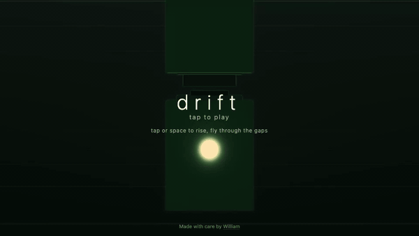

<!-- portfolio
name: "Drift"
tagline_en: "One file. One input. One more try."
about_en: "One file. One input. One more try. A raymarched 3D game in a single HTML file."
-->

# Drift

A raymarched 3D take on Flappy Bird, in a single HTML file with no dependencies.

[](https://william.revah.paris/drift.html)
[](LICENSE)

**Status:** maintained · public

**Play it:** https://william.revah.paris/drift.html. Tap, click or press Space to rise; fly through the gaps.



## Why

While I was having fun with vibe coding platforms, *Flappy Bird* resurfaced in my memory, and I set the AI the following challenge: make a three-dimensional version of it. I got a thing that more or less worked, and that grew out of control with every correction and every new idea. Weeks later, to test my dear Claude a little, I challenged it to condense the code as far as it would go: from roughly 5,500 lines, we went down to fewer than 200.

The whole story: [Drift, on william.revah.paris](https://william.revah.paris/en/stories/drift/).

## How it works

- **Rendering:** one fullscreen fragment shader that raymarches signed distance functions (SDFs).
- **3D:** camera, orb and pillars are defined mathematically: no meshes, no models, no 3D library.
- **Audio:** synthesised with the Web Audio API: an ambient drone, a tap sound, a note for each gate cleared, a death sound.
- **Score:** gates cleared; the best score is kept in `localStorage`.

HTML, CSS, JavaScript and GLSL all live in `drift.html`. It needs a browser with WebGL2, and says so when there is none.

## Run locally

```bash
git clone https://github.com/w2ur/drift.git
open drift/drift.html    # macOS; any modern browser works
```

There is no build step, no server and no package manager.

## Deploy

The game is served by the portfolio site, [william-revah-paris](https://william.revah.paris), from its `public/` folder. `./sync.sh` copies `drift.html` there; it refuses to run when the destination folder is missing, and when the hub's copy holds edits this repo never had, so a fix made on the hub side cannot be overwritten in silence. Anywhere else, `drift.html` runs on any static host as it is.

## License

MIT, see [LICENSE](LICENSE).

---

Made with care by [William](https://william.revah.paris)
